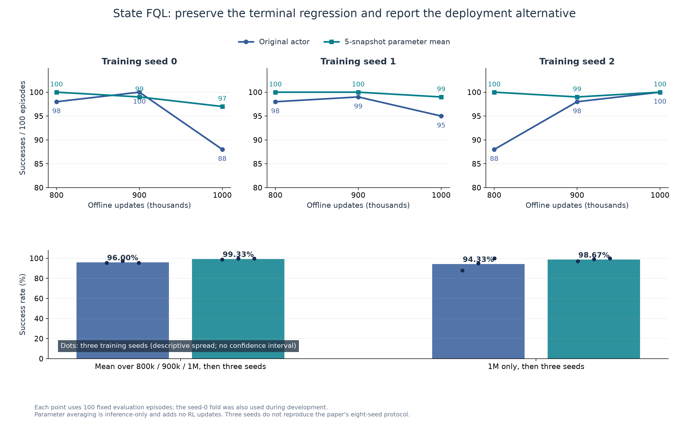
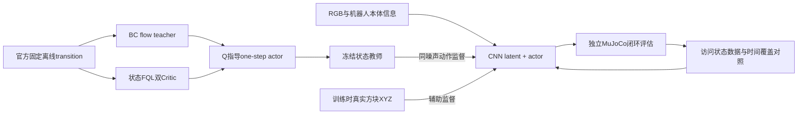
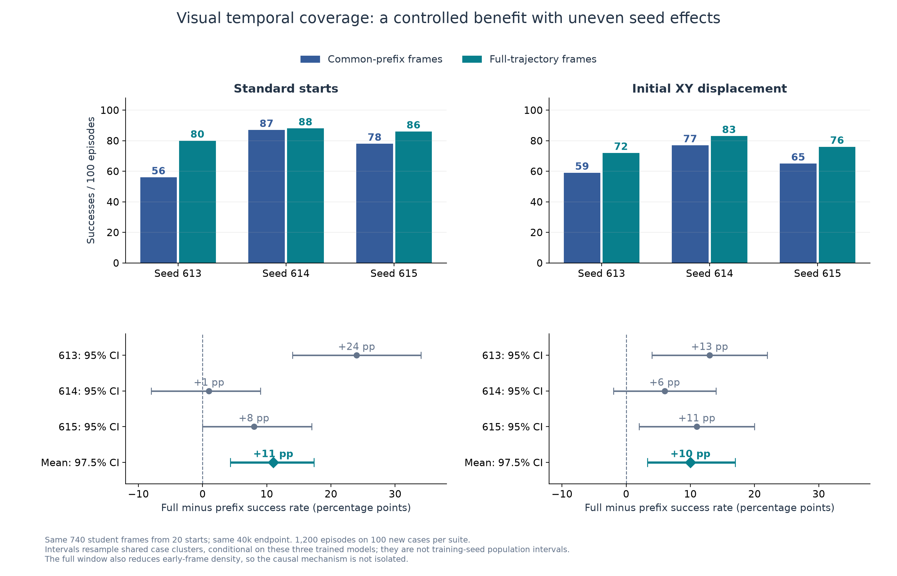
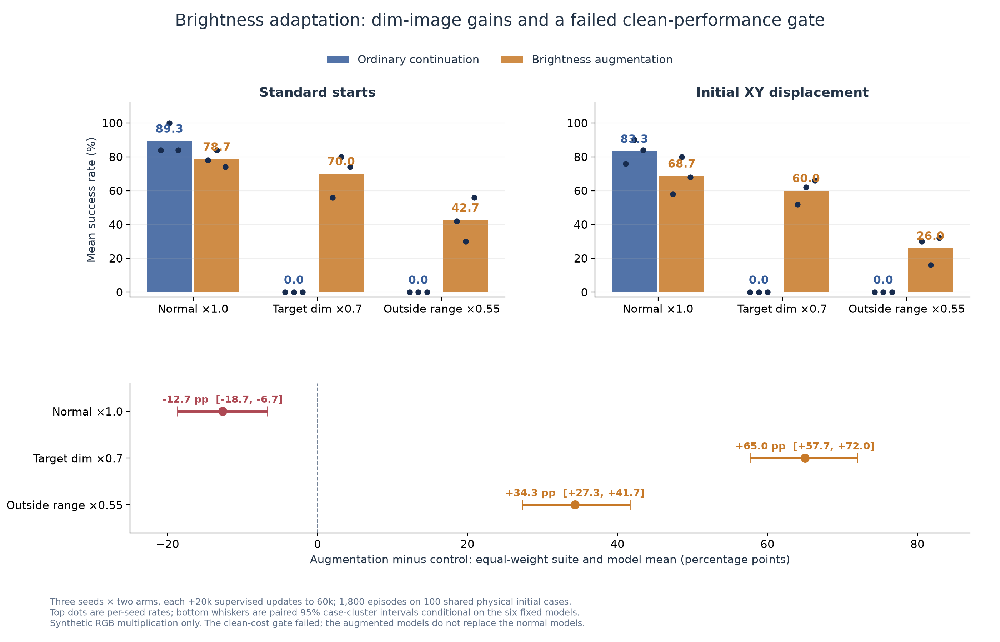

# FQL · PyTorch · Apple MPS

在 **M2 Max / 32 GB Mac** 上完成 OGBench 单方块机械臂状态离线强化学习，再将状态策略迁移为 **RGB + proprioception** 视觉策略，并用受控实验研究轨迹覆盖与图像亮度鲁棒性。

项目负责人：[Amireux / BlueAmireux](https://github.com/BlueAmireux) · 初步结题：2026-10-13  
基础论文：[Flow Q-Learning，ICML 2025](https://proceedings.mlr.press/v267/park25f.html)。本仓库保留原作者源码与版权；工程移植和实验范围见完整报告。

## 结果速览

| 实验 | 已验证结果 | 口径 |
|---|---|---|
| 状态FQL，3种子各1M更新 | 原actor **96.00%±1.15pp**；固定五快照参数平均 **99.33%±0.58pp** | 每seed先平均800k/900k/1M，再跨seed均值/样本SD；每点评估100回合 |
| 视觉时间覆盖共同确认 | 标准 **+11pp**；初始位置偏移 **+10pp** | 三固定模型、200个共同物理病例、1200回合；配对cluster区间 |
| 亮度增强 | 像素×0.7 **+65pp**；正常图像 **−12.7pp** | 同父模型/预算/RNG，三种子，1800回合；正常代价不通过，未替换默认模型 |
| Mac同供电1000更新测速 | JAX **65.31/s**，Torch compiled/fused **56.28/s** | 同固定真实batch、逐次同步、去首更新后统计999次；本次Torch慢13.82% |



**结果边界：**这是一个状态任务的三种子复现和自建视觉监督迁移项目。没有完成原论文八种子全协议，没有新增视觉FQL Critic/RL训练，也没有语言、多任务或真实机器人测试。seed0末期回落、视觉正常性能代价和失败视频均保留。

## 核心内容

- [完整项目报告](docs/FINAL_REPORT.md)：算法、移植校验、实验链条、全部关键结果、失败与局限。
- [从安装到训练/重载/演示](docs/RUN_GUIDE.md)：可复制命令及文件职责。
- [可复查范围与证据](docs/REPRODUCIBILITY.md)：公开版能重做什么、不能重做什么。
- [九个最终推理模型](models/README.md)：全部种子与来源SHA；无需离线数据即可加载。
- [展示素材与固定病例](assets/README.md)：图表、视频及成功/失败标签。

## 结构与数据流



```text
docs/                     完整报告、运行教程、公开边界
复现/fql/pytorch/          冻结PyTorch算法、训练、评估与视觉研究源码
upstream/fql/             官方FQL固定源码快照
models/                   3状态avg5 + 6视觉control/aug便携推理权重
evidence/                 逐回合CSV、精简结果/协议、来源与统计重算材料
assets/                   结果图与原样固定病例视频
tools/                    下载、模型核查/demo、结果重算、绘图与导出
```

## 快速加载与复查

需要Python3.11；在仓库根目录创建独立环境。Apple GPU的后端名称是 **MPS**。

```sh
python3.11 -m venv .venv
source .venv/bin/activate
python -m pip install -r 复现/fql/pytorch/requirements.in
python tools/verify_models.py --device cpu
python tools/verify_results.py
```

Apple Silicon且MPS可用时可以执行 `python tools/verify_models.py --device mps`。无数据的MuJoCo短演示：

```sh
python tools/demo.py --model visual_seed613_control --episodes 3 --output runs/visual_demo
```

结题阶段只对新便携导出做CPU/MPS重载与动作探针验证，没有用这个新demo工具追加环境评估；正式闭环结果来自保留的历史评估证据。三回合demo仅看行为，不能当正式成功率。首次Mac图形调用可能要求操作系统权限，渲染支持取决于本机环境。

公开版支持下载官方数据后从头训练状态FQL；完整历史视觉重训还依赖未上传的父checkpoint、渲染/访问状态数据。推理模型不含Adam/RNG，不能作为严格续训checkpoint。

## 展示重点





可直接查看 [状态阶段成功视频](assets/videos/state_seed0_500k_fixed_ep0.mp4)、[视觉阶段成功视频](assets/videos/visual_full40k_seed613_standard_ep0.mp4)与素材清单中的最终固定对照。阶段视频不代表最终三种子平均成绩。×0.7固定seed613病例两臂都失败，也保留在素材目录。

## 归属

项目维护与提交使用负责人身份。FQL、OGBench和依赖的原作者版权保留，见 [THIRD_PARTY_NOTICES.md](THIRD_PARTY_NOTICES.md)。项目新增工程代码使用MIT；引用的第三方源码按其原许可，数据不因本仓库而重新许可。
