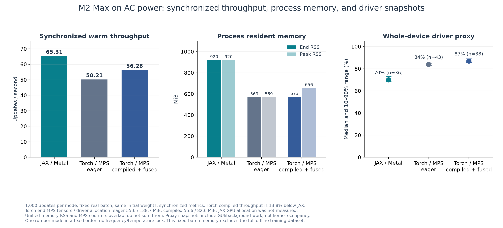
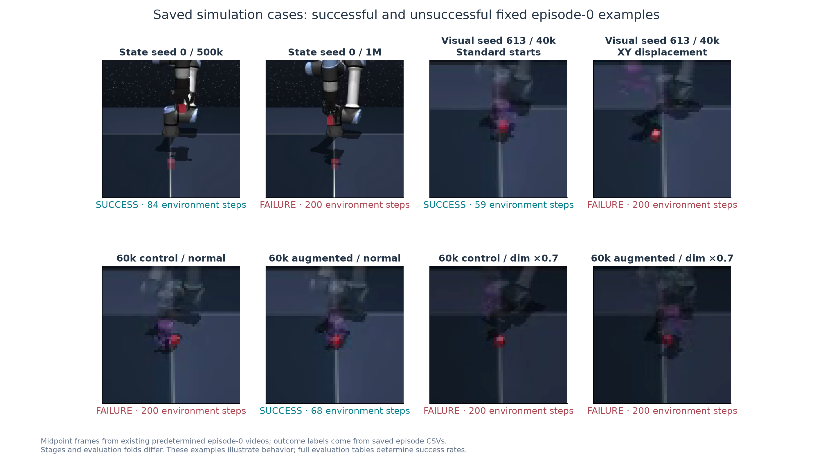

# FQL：Apple Silicon 上的离线强化学习与视觉策略迁移

**项目负责人：Amireux（GitHub：BlueAmireux）**  
**初步结题：2026-10-13。** 本报告汇总已经完成的实验；结题整理不追加训练或环境评估。结果单位为成功率，差值使用百分点（pp）。

## 1. 项目结论与交付范围

项目从 FQL 官方实现出发，在 M2 Max / 32 GB Mac 上实现了 PyTorch/MPS 状态离线 RL，并在 OGBench 单方块机械臂仿真上完成三个训练种子、每种子 100 万次更新。之后把固定状态教师迁移为 RGB + 机器人本体信息的视觉策略，围绕实际访问状态、轨迹时间覆盖及亮度扰动开展受控实验。

| 已完成工作 | 可支持的结论 | 不能据此声称 |
|---|---|---|
| 官方源码固定、完整数据核查、数值对齐、断点恢复、独立 MuJoCo 评估 | PyTorch/MPS 的工程闭环已运行 | 只完成安装就复现论文成绩 |
| 状态 FQL：3 × 1M 更新，末三个评估点 | 原 actor 为 **96.00% ± 1.15pp**；五快照参数平均为 **99.33% ± 0.58pp** | 原论文八种子、全任务完整复现；普遍优于原论文 |
| 三固定视觉模型的共同病例确认 | 全时间覆盖相对匹配前缀，标准 **+11pp**、偏移 **+10pp** | 视觉 FQL 端到端 RL；训练种子总体上的置信区间 |
| 三种子亮度增强配对实验 | 暗图 ×0.7 平均 **+65pp**，同时正常图像 **−12.7pp** | 增强全面改进；真实光照或实机鲁棒性已经验证 |
| 同供电条件各 1000 更新测速 | 此次 compiled/fused Torch 比 JAX 吞吐低 **13.82%** | PyTorch 在所有模型/硬件上都更慢 |

交付包括固定上游快照、PyTorch 工程源码、最终推理模型、逐回合紧凑证据、重算/绘图工具、视频与本报告。原始完整训练 checkpoint、优化器/RNG、衍生视觉数据和历史轨迹在本地保留；公开版推理导出不包含这些训练状态。

## 2. 论文、上游与个人工作的边界

复现对象为 Seohong Park、Qiyang Li、Sergey Levine 的 **Flow Q-Learning**，ICML 2025，PMLR 267:48104–48127，arXiv:2502.02538。[正式论文](https://proceedings.mlr.press/v267/park25f.html)、[官方代码](https://github.com/seohongpark/fql)。固定代码提交为 `e8cd16eb490332924dfa2492097219f181765933`，公开版 [upstream/fql](../upstream/fql) 保留原字节和 MIT 版权。结题核查 23 个常规文件与归档逐字节相同。

作者提供了 JAX/Flax 算法、训练入口和 OGBench 使用方式；OGBench 提供仿真任务与离线数据。开源代码、开源数据、预训练权重和本机可运行是不同事项。本项目实际使用官方数据，从头训练 PyTorch 状态模型；没有把官方预训练结果当作本项目训练结果。

本项目的工程与实验工作是：独立依赖环境、Mac 后端适配、四损失及优化顺序的 PyTorch 迁移、数值与恢复核查、吞吐/内存测量、三种子长训、固定参数平均部署、视觉状态教师迁移、访问状态数据构建、对照与配对统计、模型/证据发布。参数平均和亮度增强本身是已有技术；项目贡献在于基于具体失败提出假设，设计并核查受控实验，而不是声称发明新的 FQL 理论。

官方 FQL 论文已经包含视觉实验。本项目的视觉部分是自建数据上的监督迁移，不是作者视觉 FQL 的复现，也不包含语言输入或 VLA 预训练。

## 3. 任务、输入输出与数据

| 项目 | 状态策略 | 视觉学生 |
|---|---|---|
| 环境 | `cube-single-play-singletask-v0`，固定 task2 | `visual-cube-single-singletask-task2-v0` |
| 观测 | 28 维：机器人 19 + 方块 9 | 64×64 front RGB + 19 维机器人本体信息 |
| 策略噪声 | 5 维高斯 z | 同样 5 维高斯 z |
| 动作 | 5 维，裁剪到 [−1,1] | 同左 |
| 仿真频率/上限 | 20 Hz / 200 步 | 同左 |
| 成功口径 | 方块中心距 task2 目标 ≤4 cm 的官方 `info['success']` | 同左 |

动作控制末端相对 xyz、yaw 与夹爪开合，经环境低层 IK/PD 执行，并非直接输出五个关节角。目标位置为 `[0.5, 0, 0.02]`。实测策略通常抓取、抬起后移动；官方判定仅使用目标距离，不规定必须抬起、释放或稳定保持。因此视频中“移动到目标成功”不能写成完成了额外的放置稳定性测试。

状态训练使用官方 `cube-single-play-v0`：有效训练 transition 1,000,000，验证 100,000；不是本项目自己采集的百万条演示。数据按官方轨迹切分，视觉衍生数据也保持整轨迹训练/验证隔离。

| 官方文件 | SHA256 |
|---|---|
| `cube-single-play-v0.npz` | `80f3b6fd27f4f9d9e9eb6f0d07d6951559012f45b1e15ea4046ef8ecd8d3684e` |
| `cube-single-play-v0-val.npz` | `96d07401bdebdc3f0ea6d56ed1333863e0962f441483adc2c43b83105046eb00` |

数据适配保留官方 reward=`success−1`、mask=`1−success`，动作按官方规则裁剪到 ±(1−1e−5)。969 个轨迹结束但 mask=1 的样本保留，不擅自把所有轨迹边界改为 Bellman 终止。真实 batch 随机抽取 transition，形状为 `(256,28)` 的 s/s′、`(256,5)` 的 a，及 256 个 reward/mask。

## 4. 状态 FQL：四损失训练谁

实现保留两组 actor 和双 Q 网络；术语“teacher”在状态 FQL 与后续视觉迁移中含义不同。

| 损失 | 输入与训练信号 | 更新对象 |
|---|---|---|
| Critic TD | 数据动作 `(s,a_D)`，reward/mask，s′ 的目标策略动作与 target Q | 两个 Critic |
| BC flow matching | 在噪声 z 与数据动作 a_D 之间取一个随机 t 的插值点，拟合速度 `a_D−z` | BC flow 网络 |
| Actor distillation | 固定 BC flow 的多步积分动作作为目标，拟合 one-step actor | one-step actor |
| Actor Q loss | one-step actor 动作经 Critic 评分，优化负 Q | one-step actor；此分支不更新 Critic |

默认 batch256、4层×512 MLP、float32、Adam lr=3e−4、discount=0.99、tau=0.005、flow10步、alpha=300、双 Q 均值。四项组合使用一次 Adam 更新；target 更新使用此次 Adam 之前的 Critic 参数。梯度边界及这个时序均核查，不能只根据最终 loss 相近判断实现正确。

BC flow 的训练每次仅计算随机 t 的一个插值点；不能把它写成每次都对十步 ODE 做 BPTT。部署使用 one-step actor 的一次前向，避免逐步 flow 采样成本。

## 5. Mac 与 PyTorch 工程迁移

### 5.1 环境与运行闭环

实测环境：M2 Max / 32 GB、macOS 26.6.2、Python 3.11.16、PyTorch 2.14.1、NumPy 1.26.4、OGBench 1.1.0、MuJoCo 3.2.7、Gymnasium 0.29.1。精确依赖见 [requirements.lock.txt](../复现/fql/pytorch/requirements.lock.txt)，可安装约束见 [requirements.in](../复现/fql/pytorch/requirements.in)。这是实测版本记录，不保证任意未来版本自动兼容。

训练使用 Apple **MPS** 后端，不是 CUDA，也不是 MCP。MuJoCo 环境仿真在 CPU，图像渲染通过本机图形接口；神经网络训练放到 MPS。这些工作可以组合，但不能说 MuJoCo 的物理仿真全部在 Mac GPU 上运行。

推进顺序为：独立环境 → reset/step 与数据 SHA → 真实更新 → 同 batch 数值核查 → 1000 次测速/短训 → 新进程 checkpoint 重载 → 独立评估/视频 → 更长训练。早期 JAX/Metal 原生 Python 崩溃与退出绕行记录保留，随后主训练切换到独立 PyTorch 环境；没有把两条链连成一条连续训练轨迹。历史 JAX 17,500 更新的 7/10 与 Torch 后来的结果不可直接比较为迁移提升。

### 5.2 迁移正确性

固定真实 batch、官方初始参数和参考随机量，检查参数映射、前向、四损失、逐损失梯度、总梯度、Adam 一次更新、一/二阶矩、target 顺序。CPU foreach、CPU fused、MPS fused 均在预定容差内通过。

| 代表核查 | 最大绝对误差/结果 |
|---|---|
| 56 个参数叶映射 | 0 |
| CPU 前向 | 5.25e−6 |
| 11 个损失/度量叶 | 1.53e−5 |
| 总梯度 | 1.43e−6 |
| 一次 Adam 参数：CPU / MPS | 8.78e−5 / 6.03e−5，按原预定容差通过 |
| target 顺序与一次 Adam 约束 | 0 |

同设备新进程恢复，比较连续20次与10次→保存→重载→10次。CPU 180 tensor/74 scalar、MPS compiled/fused 181 tensor/73 scalar 的模型、Adam、RNG、采样器、下一批、11–20次 batch/metrics 均严格相同。

这些证据支持“一次更新正确、短续训严格恢复”，不证明 JAX 与 Torch 长期完全相同，也不证明所有长训练中间步均逐位可复现。框架 RNG、浮点归约/融合及累计误差都可能使长期模型不同。JAX checkpoint 的形状相似也不代表可以直接交给 Torch optimizer；本项目未交付跨框架严格续训转换。

### 5.3 性能测量与原因分析

供电对比三次边界均为 AC、电量80%。每种模式1000次同初始官方参数、同固定真实batch、float32、等价四损失/梯度统计；每次同步，去除第一次后统计999次。固定执行顺序 JAX→Torch eager→Torch compiled/fused，已有编译缓存，一种模式只跑一次。

| 模式 | 预热后更新/s | 末 RSS / 峰值 RSS（MB） | MPS tensor / driver 末值（MB） | 全设备驱动占用中位数 |
|---|---:|---:|---:|---:|
| JAX/Metal | 65.31 | 964.94 / 964.94 | 没有可比计数 | 70% |
| Torch eager | 50.21 | 596.48 / 596.48 | 58.33 / 145.41 | 84% |
| Torch compiled/fused | 56.28 | 600.65 / 687.62 | 58.34 / 86.64 | 87% |

此次优化后的 Torch 吞吐比 JAX低13.82%，每次更新耗时高16.03%；Torch 末 RSS 较低。RSS、MPS tensor 和 driver 计数在统一内存下有重叠，不能相加作为总内存。驱动百分比是全设备采样代理，包含 GUI 和其他程序，既非本进程占用也非理论 FLOPs 利用率。更高占用与更低吞吐同时存在，说明占用不能代替任务效率。

合理解释是 JAX 的编译/融合方式、Torch 的算子调度、kernel 数量、同步和统计开销不同；小型 MLP 与 flow 循环可能让启动/调度开销更突出。compiled/fused 实测改善 eager 吞吐，但没有 profiler 分离各项，因此这些属于机制假设，不能断言某个 kernel 是瓶颈。未锁定温度/频率，编译缓存和执行顺序也可能影响结果。

实际长训把全量训练数据打包为1M×63 float32（252 MB），放在 MPS，减少 CPU→GPU搬运与逐步同步，只按约定间隔记录。历史低同步 loop 的135.64/s等数值属于另一种计时范围，不能与上表混用。选择 Torch 是为 PyTorch 工程栈及 MPS 稳定运行，不是因为已经证明它比 JAX 快。

## 6. 三种子状态训练与参数平均

seed0、1、2各完成1M optimizer updates；更新次数不是环境交互步数。离线训练没有新交互用于更新，独立评估另记环境步数。参数、数据、alpha等算法配置固定；中途按用户要求精简日志，保留关键 checkpoint、正式评估与恢复边界。

正式终点800k、900k、1M，每模型100回合。参数平均仅在**同一种子**最近五个 actor快照中，按10k间距固定取 E−40k…E，CPU float64求均值后cast float32；不平均 Critic/BC教师/Adam，不跨种子，不进行五模型在线投票，也不增加 RL 更新。

| seed | raw 800k | raw 900k | raw 1M | avg5 800k | avg5 900k | avg5 1M |
|---|---:|---:|---:|---:|---:|---:|
| 0 | 98/100 | 100/100 | 88/100 | 100/100 | 99/100 | 97/100 |
| 1 | 98/100 | 99/100 | 95/100 | 100/100 | 100/100 | 99/100 |
| 2 | 88/100 | 98/100 | 100/100 | 100/100 | 99/100 | 100/100 |

评分先在每个seed内平均末三个点评估成功率，再对三个seed求均值与样本标准差（ddof=1）：raw **96.00%±1.15pp**，avg5 **99.33%±0.58pp**；平均差为+3.33pp。仅1M终点的三个seed均值另为 raw **94.33%**、avg5 **98.67%**。末三点均值不是某个唯一 checkpoint 的成绩。

seed0 raw从900k的100/100回落到1M的88/100，原结果保留；1M的avg5为97/100，配对病例救回10例、新增失败1例，净+9pp，病例bootstrap95%区间[3,16]pp。它是部署层缓解，不构成对回落原因的因果解释。seed2反而从800k的88/100到1M的100/100，因此不能说所有种子都发生后期崩溃。

当前决定停止继续诊断。没有证据把回落确定归因于过拟合、Q值偏差或MPS数值漂移。面试中应直接给出原始回落、固定窗口验证和未隔离机制，而不是宣称 bug 已修好。

原论文该状态任务报告97%±2pp，状态实验采用8个训练种子、1M更新、每100k评估50回合、末三个点平均。当前只有3种子、每点100回合，包含开发seed0，9000系列病例已在开发中使用；avg5又是额外部署适配。因此可以说完成了选定任务的三种子复现与部署实验，不能说完成原论文全协议，也不能凭99.33%断言显著优于原方法。来源字段见 [evidence_summary](../evidence/evidence_summary.json)。

## 7. 视觉方案：从真实失败到数据改进

### 7.1 模型与信号

冻结状态seed0/960k的 **one-step actor** 作为视觉教师，与状态FQL内部BC flow教师区分。RGB经3层CNN（32/64/64）、4×4池化与128维层映射为9维latent，和19维proprio拼成28维后进入4×512 actor；actor由状态教师初始化。训练时潜变量前三维用方块XYZ辅助监督（中心`[0.425,0,0]`、xyz尺度10），其余六维由动作损失学习。

损失为同一z下的未裁剪教师/学生动作MSE + 权重1的XYZ监督；Adam lr=1e−4。部署仅输入RGB、proprio、z，不读取真实方块状态。教师冻结，没有视觉Critic，没有新增FQL RL更新。这是 privileged-state supervision + policy distillation。

### 7.2 开始阶段与保留的失败

初始5000训练图像（50轨迹×100）/1000验证图像（10轨迹×100）来自官方状态轨迹重渲染。最初严格yaw/cache状态重构不通过，旧失败保留；v2核查可重构几何、保留原标签yaw。它不是“全部状态完美重构”的证据。

直接动作蒸馏20k更新为0/50；加入XYZ监督后的grounded20k为12/50。低离线动作误差不能自动代表闭环成功：视觉误差会改变访问状态，固定演示数据可能没有覆盖这些状态。

### 7.3 访问状态监督与初步消融

在实际学生/教师轨迹上采集状态、RGB、proprio、z与冻结教师动作目标；学生访问的失败状态也能得到教师标签。初版学生池5131帧/60回合，教师池851帧/20回合；训练混合旧数据与新访问状态数据。

同父模型、同追加20k监督预算的独立确认中，mixed40k标准49/50、偏移44/50，而只用旧数据续训为13/50、11/50。零图像输入标准0/50表明模型不能在该极端输入下完成任务；不能把它升级为所有视觉因果机制的证明。

随后同一视觉初始化的开发消融：teacher-only标准11/30、偏移6/30；student-only29/30、28/30；mixed30/30、28/30；old-only2/30、7/30。由于学生/教师池样本量与覆盖不同，不能简单把差异解释为“学生行为比教师行为更好”，也不能用这批开发数字替代上一批独立确认。

### 7.4 数量匹配揭示时间截断

进一步构建20对训练病例、学生与教师各740帧，原始每两步取pre-action帧；同初态/初始RGB、同共同时间下标和噪声，验证另有6对完整留出病例（各197帧，共394）。匹配前缀以两条轨迹较早结束为界，学生失败通常更长，导致其后段1017候选帧被排除。

匹配前缀开发结果 student-only18/30、20/30，teacher-only15/30、13/30；标准任务差值+10pp的区间[−13.3,30]pp，偏移+23.3pp的区间[0,46.7]pp。它提示收益不稳定，不能继续用数量不匹配的初版结果宣称机制已确定。

改进保留每病例帧数Ni，从该学生完整轨迹候选均匀取 `rint(linspace(0,M_i−1,N_i))`，仍为740帧，其中341来自此前排除的后段、399保留前段。教师740帧原件保留；正式比较使用旧数据128 + 学生数据64 +64的batch构成，不把教师池混进这一对照。无需新增采集。

这项改变同时调整早期采样密度与后段覆盖；“失败后段监督是唯一原因”仍未隔离。所有访问数据来自固定采集seed613/状态教师seed0，后续视觉三训练种子条件于这份共同数据。

## 8. 三固定视觉模型的共同确认

开发后固定seed613、614、615的prefix/full40k模型，在共同新病例上做标准100、偏移100回合，六模型共1200回合、200个物理病例cluster；不追加训练。标准env/action起点130000/131000，偏移132000/133000。偏移位于采集所覆盖的范围，不能写成空间外推。

| seed | 标准 prefix→full | 偏移 prefix→full |
|---|---:|---:|
| 613 | 56→80 /100 | 59→72 /100 |
| 614 | 87→88 /100 | 77→83 /100 |
| 615 | 78→86 /100 | 65→76 /100 |
| 三模型均值 | 73.7%→84.7% | 67.0%→77.0% |

按物理病例cluster做10000次配对bootstrap（seed20261019），保留同病例的三个模型和两臂：标准+11pp，95%[5.3,16.7]pp、97.5%[4.3,17.3]pp；偏移+10pp，95%[4.3,16.0]pp、97.5%[3.3,17.0]pp。两项97.5%区间下界均大于0。

区间衡量这三个固定模型对所采病例的波动，不能看成训练种子总体的置信区间。600个seed-case配对中救回98、新增失败35，不是98个独立物理病例。开发seed615标准结果曾22/30低于prefix25/30，保留这个反例，不能把不同病例结果拼成单调上升曲线。

共同确认共141935环境步，双CPU进程控制器耗时561.16秒；逐步成功/reward/终止核查与4662次已保存动作重推通过，最大动作误差2.09e−6。这里的动作抽样审计范围不等于所有视觉轨迹每个动作均重算。

## 9. 亮度诊断与一次增强实验

### 9.1 诊断与干预

三个固定full40k模型、标准/偏移各50个新病例，对比正常RGB与像素×0.7，共600回合：正常242/300（80.7%），暗图0/300。变换为float32乘系数、nearest-even rint、clip并转uint8，不改变物理场景/状态/目标。这是图像亮度压力测试，不是真实灯光或sim-to-real验证。

满足事前诊断门槛后做一轮实验：每个40k父模型分成control与augmentation，各追加20k监督至60k。两臂父参数、Adam、CPU/MPS RNG、PCG采样器相同；control也消耗同样unused factor抽样，隔离增强分支的RNG差异。增强对每个训练图像乘Uniform[0.7,1.3]系数。未新采集数据，也未更新FQL Critic。

固定60k终点，不按测试结果挑checkpoint。新标准138000/139000、偏移140000/141000；3seed×2臂×2suite×3条件×50回合=1800回合。暗图×0.7为主要鲁棒性条件，×0.55为训练系数范围之外的次级压力测试。

### 9.2 结果与决策

| 图像条件 | 标准 control→aug | 偏移 control→aug | 两suite等权宏平均变化（95%病例区间） |
|---|---:|---:|---:|
| 正常 | 89.3%→78.7% | 83.3%→68.7% | **−12.7pp [−18.7,−6.7]** |
| ×0.7 | 0%→70.0% | 0%→60.0% | **+65.0pp [57.7,72.0]** |
| ×0.55 | 0%→42.7% | 0%→26.0% | **+34.3pp [27.3,41.7]** |

正常control259/300、aug221/300；×0.7 aug195/300；×0.55 aug103/300。按100个物理病例cluster配对bootstrap10000次（seed20261021），整列保留六个模型与三个亮度条件，两suite等权。这里也不是训练种子总体区间。

事前门槛为：暗图平均收益≥10pp且95%下界>0；正常平均差≥−5pp且95%下界≥−10pp。主暗图收益门槛通过，正常性能代价的两项条件均失败。因此最终保留**正常control60k作为默认视觉模型**，augmentation60k仅作为暗图专项模型，拒绝用它替换默认模型。不能只展示暗图65%的改善而隐藏正常−12.7pp。

初始相同帧XYZ的六组均值RMSE：正常control2.48cm/aug2.14cm，×0.7为26.61/2.42cm，×0.55为43.24/3.81cm；正常首帧估计更准仍伴随闭环成功下降，留出394帧XYZ指标在三个增强seed中均差于control。证据支持亮度表征有所改善，不能证明正常闭环下降只由某一个原因导致。

六分支共120k监督更新，训练控制器1258.78秒、评估1135.20秒/277324环境步。12个41k/60k checkpoint及分支恢复核查通过；11526个保存的ep0/probe动作重推最大误差6.54e−6；1800回合的噪声、reward、4cm成功/终止元数据核查通过。分支峰值RSS约0.684–0.708GiB，MPS allocated约152.5MB；该长训没有GPU占用序列，不宣称占满GPU。

## 10. 最终模型与展示素材

| 模型 | 发布版本 | 用途与边界 |
|---|---|---|
| state avg5 seed0/1/2 | 最后960/970/980/990/1000k actor参数平均 | 状态推理；1M点97/99/100成功，推理导出不能续训 |
| visual control seed613/614/615 | full40k父模型+20k普通监督，60k | 正常图像默认；标准89.3%、偏移83.3%是三模型均值 |
| visual augmentation seed613/614/615 | 同父模型+20k亮度增强，60k | 暗图专项；正常性能代价必须说明 |

对应来源SHA、架构、导出SHA、动作探针见 [models](../models)，加载/演示见 [运行指南](RUN_GUIDE.md)。公开推理格式显式排除Adam、Critic、训练RNG与本机路径；原始CP留在本地，原SHA不变。全部种子一并提供，不用最好的一个代表总体。

展示视频来自已有正式/阶段评估的固定ep0，保留成功与失败，完整来源见 [showcase_manifest](../evidence/showcase_manifest.json)。可观看状态500k阶段成功案例、视觉full40k共同确认的标准成功案例，以及最终seed613正常/暗图control/aug固定对照。前两项是阶段案例，不是最终模型统一成绩；最后seed613的标准×0.7 ep0两臂均200步失败，不能替换成成功片段冒充固定配对。

旧的first_success_replay是评估后选取的定性回放，不能作成功率或随机代表性证据；本报告的主展示采用清单中固定案例。视频服务于观察行为，表格/逐回合数据才支持成功率。

## 11. 可复查性与公开边界

公开 [evidence](../evidence) 提供紧凑汇总、关键协议和逐回合CSV，保留原相对路径/字段与SHA。公开JSON是显式标记的脱敏派生副本，删除本机路径等无关信息，不冒充原记录字节副本。`tools/verify_results.py`可仅凭公开证据重算展示的成功数和配对统计；`tools/plot_showcase.py`用公开compact数据重绘图表。

本轮结题独立核查87组历史CSV、5850回合的成功数/回合数、关键均值、展示媒体哈希及官方源码快照。该5850是此次核对集合，不是整个项目所有交互的总量。旧数值对齐、短恢复、轨迹重推审计按原记录引用，不因整理报告重新执行训练或环境评估。

公开版可安装依赖、重载九个推理模型、无数据执行MuJoCo demo，并在下载官方数据后从头训练状态FQL。历史视觉全阶段重训还需本地的父模型、paired_data、采集轨迹与衍生数据；公开源码保留这些阶段执行器供审查，但不是开箱即复跑全部历史视觉实验。公开推理导出探针一致性验证不等于在公开副本再次评估成功率。

项目仍未解决：seed0后期回落的因果机制、时间覆盖与早期重采样的独立作用、亮度增强正常性能代价、跨训练种子总体不确定性、额外任务/相机/真实机器人泛化。用户决定初步结束，不把这些写成已经修复的问题，也不将后续建议列成正在运行的任务。

## 12. 面试中可以据实展示的能力

可以沿“官方算法→工程校验→长期训练→观察失败→受控改进→保留代价”讲述：能够把JAX算法迁移到Torch/MPS；理解四损失训练边界与target更新时序；处理真实数据、GPU同步/内存、严格恢复和独立评估；用视觉状态教师把低维策略迁移到RGB输入；识别访问状态与轨迹截断偏差；做同父模型、同预算、同病例、同RNG的对照；用配对cluster统计与原始失败约束结论。

这些是已完成项目的工程和实验能力证据；文档和运行记录不等于负责人已经独立掌握，个人操作与复述仍需自验。项目没有语言、多任务、真机部署或新算法理论证明；不应包装为新的通用VLA方法、全论文复现或所有条件下性能提升。

## 13. 参考与版权

- [FQL正式论文](https://proceedings.mlr.press/v267/park25f.html)与[官方源码](https://github.com/seohongpark/fql)。
- [OGBench官方源码与数据入口](https://github.com/seohongpark/ogbench)，任务和数据由原作者提供。
- [MuJoCo](https://github.com/google-deepmind/mujoco)、[PyTorch](https://github.com/pytorch/pytorch)作为依赖，不重新许可其全部资产。
- 项目MIT及第三方归属见 [LICENSE](../LICENSE)、[THIRD_PARTY_NOTICES](../THIRD_PARTY_NOTICES.md)。工程维护和Git提交使用项目负责人的身份；原作者与依赖版权保留。
